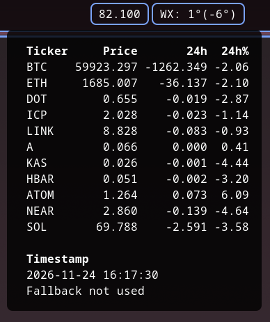

# Waybar cryptocurrency indicator

Cryptocurrency quotes for Waybar, powered by [CoinMarketCap API](https://coinmarketcap.com/api/).
Shows the first coin in the bar, with the remaining coins and their 24-hour changes
in the tooltip.

## Setup

Install Go and Task, then run from the `cryptocurrency` directory:

```sh
task prod
```

Add this definition to your Waybar configuration and include `custom/cryptocurrency`
in your module list. It updates every 30 minutes:

```jsonc
"custom/cryptocurrency": {
    "max-length": 15,
    "return-type": "json",
    "format": "{}",
    "exec": "$HOME/.config/waybar/scripts/cryptocurrency",
    "interval": 1800
}
```

## Configuration

Set these environment variables in Waybar's environment or prefix the `exec`
command with them:

| Variable | Description | Default |
| --- | --- | --- |
| `CRYPTO_CURRENCY_API` | CoinMarketCap API token (required) | None |
| `CRYPTO_CURRENCY_FV` | Conversion currency ID | `2781` (USD) |
| `CRYPTO_CURRENCY_WL` | Comma-separated coin IDs, in display order | `1,1027,6636` (BTC, ETH, DOT) |

Use numeric CoinMarketCap IDs rather than ticker symbols. The first coin in
`CRYPTO_CURRENCY_WL` appears in the bar; the remaining coins appear in the tooltip.

To look up coin IDs by ticker symbol, use curl and jq:

```sh
curl -G 'https://pro-api.coinmarketcap.com/v1/cryptocurrency/map' \
    -H 'X-CMC_PRO_API_KEY: <your_api>' \
    -H 'Accept: application/json' \
    --data-urlencode 'symbol=BTC,ETH,DOT' | jq .
```

## Fallback

Results are saved automatically. If an update fails, the indicator uses the last
successful result for the same conversion currency and coin list, including its
order, keeping the original timestamp.
The tooltip shows `Fallback not used` for fresh results and `Fallback used` for
saved results. If no matching saved result exists, the command logs an error and
exits.

## Preview


